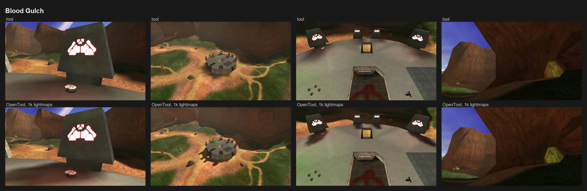
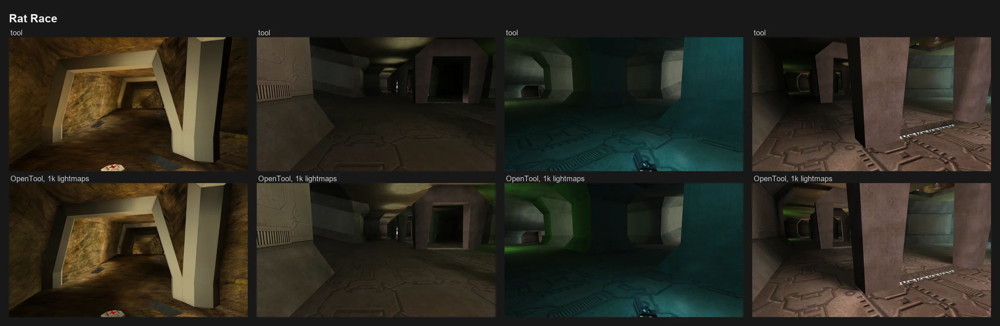
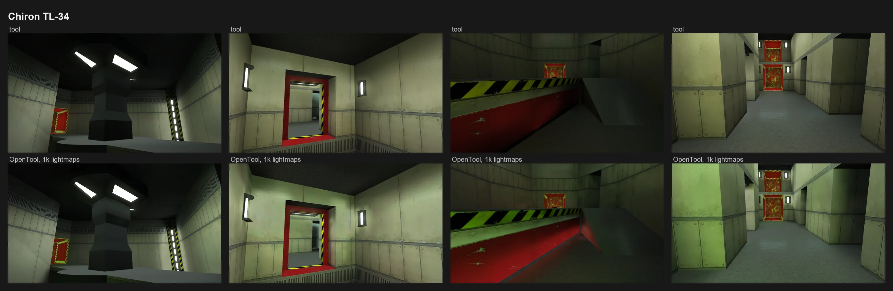

# OpenTool

OpenTool is a set of command-line tools that rebuild parts of the Halo: Combat Evolved editing kit's `tool.exe` in Python, so each step can be read, tested and changed. It is a research and learning project: it changes often, and its results are checked against tool's own.

OpenTool is developed alongside [OpenCE](https://github.com/OpenCommunityEdition/OpenCE), the open-source port of Halo: Combat Evolved to Linux, Windows, Android and the web. Everything it writes today is ordinary tags in the stock format of the Halo: Combat Evolved Anniversary (H1A) editing kit in MCC, so the results also work in MCC and with the editing kit's own tools. Nothing in it needs OpenCE yet. Features that only OpenCE can use are planned for later and will sit behind a switch.

## Tools

| Tool | Replaces | Status | Documentation |
|---|---|---|---|
| Lightmapper | `tool lightmaps` | Usable | [docs/lightmapper.md](docs/lightmapper.md) |
| Structure BSP builder | `tool structure` | Not started | See the roadmap below |

The rest of the editing kit's work (bitmaps, models, sounds, scripts, building maps) is out of scope. Use the H1A editing kit or Invader for those.

### Lightmapper examples

Each column is one view in game in OpenCE: tool's own lightmaps on top, OpenTool's below, baked at a higher resolution than the default (lightmap pages of 1024 pixels).







## Roadmap

- Done: the lightmapper, with lightmaps that closely match tool's.
- Next: better lightmaps in the stock format, with higher resolution, better bounced light, better shadows and faster bakes.
- Next: the structure BSP builder, a replacement for `tool structure` with clearer portal errors and room for larger levels.
- Later, OpenCE only: instanced geometry and per-texel directional lightmaps, behind a switch that keeps stock output the default.

## Requirements

- Windows.
- [Python 3.11](https://www.python.org/downloads/).
- The H1A editing kit, with its tags extracted.
- For the lightmapper: [Blender 5.2](https://www.blender.org/download/) installed, and [LLVM](https://releases.llvm.org) with the Visual Studio Build Tools ("Desktop development with C++") to compile one library on the first run. [Details](docs/lightmapper.md#requirements).

## Installing

1. Download this repository (Code, then Download ZIP) and unzip it, or `git clone` it.
2. In PowerShell, in that folder:

   ```powershell
   py -3.11 -m pip install -r requirements.txt
   ```

- That's all. There is no package to install; the tools run straight from the folder.
- The docs write `python`. If `python` on your machine isn't Python 3.11, or opens the Microsoft Store, type `py -3.11` instead.
- Optional: install into a virtual environment (`py -3.11 -m venv .venv`) to keep these pinned package versions apart from your other Python projects. Running `.\.venv\Scripts\Activate.ps1` then makes `python` and `pip` in that terminal use the environment's Python. Install the requirements after activating.

## How to use

### Lightmapper

The lightmapper starts Blender in the background, builds the scene from your tags, bakes and closes Blender again. You only run one command.

1. Bake. This lights Blood Gulch into new tags, so the original level stays as it is:

   ```powershell
   python lightmap.py bake --tags "C:\HCEEK\tags" levels\test\bloodgulch\bloodgulch bloodgulch --out-bsp levels\test\bloodgulch\bloodgulch_lit --out-scenario levels\test\bloodgulch\bloodgulch_lit --work bake\bloodgulch
   ```

   | Part | What to put there |
   |---|---|
   | `--tags "C:\HCEEK\tags"` | The editing kit's `tags` folder. Or set `HCEEK_TAGS` once and leave this out. |
   | `levels\test\bloodgulch\bloodgulch` | The scenario to light: its tag path relative to the tags folder, without the extension. |
   | `bloodgulch` | The name of the BSP inside that scenario. A multiplayer level usually has one, named like the level. |
   | `--out-bsp levels\...\bloodgulch_lit` | Where to write the lit BSP and its lightmap bitmap. Optional: without it the original BSP is overwritten. Backups go in a `backups` folder next to each tag. |
   | `--no-backups` | Optional. Do not keep copies of tags that are replaced. Backups are kept by default. |
   | `--out-scenario levels\...\bloodgulch_lit` | Where to write a scenario that uses the new BSP. This is the one you build and play. |
   | `--work bake\bloodgulch` | A folder for the bake's working files and `summary.json`. Optional. |
   | `--settings settings.json` | Optional. Changes how the bake looks, for example `{"texels_per_unit": 8}` for sharper shadows. See the [settings](docs/lightmapper-settings.md). |
   | `--dry-run` | Optional. Runs the whole bake but writes no tags. |

2. Build the map as usual, for example with the editing kit, from its folder:

   ```powershell
   .\tool.exe build-cache-file levels\test\bloodgulch\bloodgulch_lit remastered
   ```

- Blender is expected in its standard folder. If it is elsewhere, set `LIGHTMAPPER_BLENDER` to the path of `blender.exe`.
- The [lightmapper guide](docs/lightmapper.md) covers the other commands: `copy`, `validate` to check a result against the stock format, and `diff` to compare it with tool's lightmaps.

## Running the tests

```powershell
python -m pip install pytest
python -m pytest -q lightmapper/tests
```

- Tests marked `ek` read stock tags. Set `HCEEK_TAGS` to your tags folder, or they are skipped.
- Tests marked `blender` run Blender. They are skipped when Blender isn't found; set `LIGHTMAPPER_BLENDER` if it is not in its standard folder.

## Repository layout

```
lightmap.py               the lightmapper's command-line entry point
lightmapper/              the lightmapper
  cli.py                  commands: bake, copy, validate, diff, calibrate
  pipeline.py             the bake from start to finish
  tagio/                  reading and writing tag files, with the tag layouts
  formats/                BSP geometry, vertices, bitmaps and scenery
  gather.py               sky lights, ambient and shader emission
  charts.py, seams.py     UV charting, packing and seam stitching
  blender/bake.py         the script Blender runs to render the light
  pages.py                denoising, ambient, tone and 16-bit encoding
  radiosity.py            per-vertex incident light vectors
  validate.py, diff.py    format checks and comparison with tool
  vendor/xatlas/          xatlas source, compiled on first use
  tests/                  the test suite
docs/                     a guide, internals and settings for each tool
```

## Working with Invader

- [Invader](https://github.com/SnowyMouse/invader) is an open-source Halo CE toolkit for building cache files, bitmaps, models, sounds, strings, tag editing and checks. OpenTool is meant to be used next to it.
- OpenTool covers jobs Invader leaves open. As of Invader 0.55, `invader-lightmap` lays out lightmap UVs but computes no lighting and writes no lightmap bitmap, and Invader has no structure BSP builder.
- OpenTool reads and writes ordinary tags, so its output can go back into an Invader workflow. So far it has been checked with the H1A editing kit and in game in OpenCE, not yet with each Invader tool.

## Contributing

See [CONTRIBUTING.md](CONTRIBUTING.md).

## Contact

For questions and discussion, find Moot on the [OpenCE Discord server](https://discord.gg/9gqcHyr5km). Report bugs as GitHub issues.

## License

OpenTool is owned by Moot and licensed under version 3 of the GNU General Public License, as published by the Free Software Foundation on 29 June 2007. See [LICENSE](LICENSE) for the exact text. It is not licensed under any earlier or later version of the GNU General Public License, or under any other license, except at Moot's discretion.

In short, you may use, study, change and share OpenTool. If you share it, changed or not, you share its source code under the same license. The lightmaps and tags OpenTool makes for your levels are yours, and this license does not cover them.

Third-party parts keep their own licenses; see [THIRD_PARTY_NOTICES.md](THIRD_PARTY_NOTICES.md).

Halo is a trademark of Microsoft. OpenTool is a fan project with no affiliation to Microsoft, Halo Studios or Bungie.
